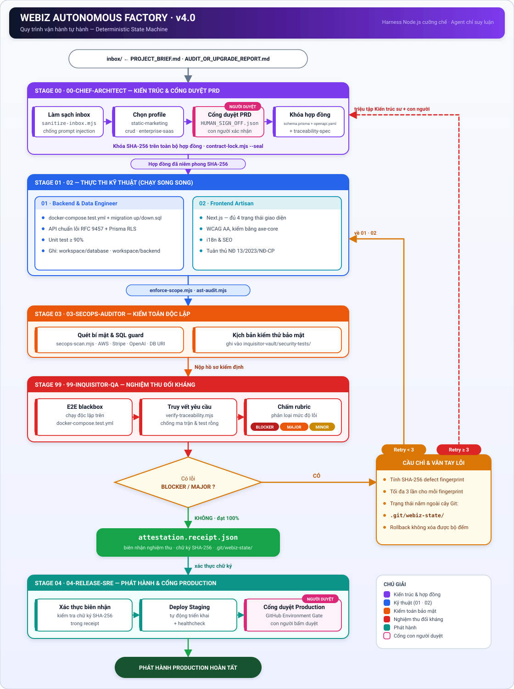

<div align="center">


# Webiz Autonomous Factory

**Nhà máy phần mềm đa tác tử (multi-agent) vận hành bằng bộ cưỡng chế tất định — không chỉ bằng lời dặn LLM.**


[Tổng quan](#1-tổng-quan) •
[Kiến trúc](#2-kiến-trúc) •
[Quy trình](#3-quy-trình-vận-hành) •
[Phân quyền](#4-ma-trận-phân-quyền-sáu-đội) •
[Bắt đầu](#5-bắt-đầu-nhanh) •
[Lệnh](#6-bảng-lệnh) •
[Lộ trình](#9-lộ-trình--hạn-chế-hiện-tại)

</div>

---

## 1. Tổng quan

**Webiz Autonomous Factory** là bộ khung điều phối nhiều tác tử AI (agent) để xây dựng một ứng dụng web từ bản yêu cầu đến khi phát hành, theo một quy trình có kiểm soát: *Kiến trúc → Kỹ thuật → Kiểm toán bảo mật → Nghiệm thu đối kháng → Phát hành*.

### Vấn đề cần giải quyết

Các hệ thống multi-agent thường chỉ dựa vào văn bản hướng dẫn cho LLM, nên dễ gặp ba lỗi:

| Lỗi thường gặp | Biểu hiện |
| :--- | :--- |
| **Ảo giác hoàn thành** | Agent báo "xong" khi chưa có test hoặc test rỗng |
| **Tự sửa cờ duyệt** | Agent tự ghi trạng thái "đã duyệt" cho chính mình |
| **Vòng lặp vô tận** | Cùng một lỗi được sửa đi sửa lại không dừng |

### Cách tiếp cận của Webiz

Webiz tách làm hai tầng:

- **Tầng suy luận (Agent Reasoning):** các agent đọc yêu cầu, thiết kế, viết code, viết test.
- **Tầng cưỡng chế (Node.js Deterministic Harness):** các script trong `scripts/harness/` kiểm tra, từ chối hoặc cấp chữ ký bằng logic tất định. Agent không thể bỏ qua tầng này.

> **Nguyên tắc cốt lõi:** *Deterministic Code Harness Over Prompt Advice* — điều gì quan trọng thì ép bằng code, không nhờ bằng lời nhắc.

---

## 2. Kiến trúc

### 2.1 Ba trụ cột

1. **Nguồn sự thật duy nhất (Single Source of Truth)**
   Thư mục `contracts/` chứa:
   - `schema.prisma` — mô hình dữ liệu
   - `openapi.yaml` — hợp đồng API, lỗi theo chuẩn **RFC 9457**
   - `traceability-spec.json` — ma trận truy vết yêu cầu

   Cả ba được niêm phong bằng băm **SHA-256**; agent kỹ thuật không được sửa trực tiếp.

2. **Trạng thái ngoại vi bất biến (`.git/webiz-state/`)**
   Bộ đếm lỗi (circuit-breaker), lịch sử bác bỏ kèm *defect fingerprint*, và biên nhận nghiệm thu `attestation.receipt.json` được lưu **ngoài cây làm việc của Git**. Nhờ vậy, lệnh rollback không xóa được bộ đếm lỗi, và agent không tự tạo được chữ ký duyệt.

3. **Cấu hình sẵn cho Antigravity**
   Rules, agents và workflows nằm trong `.agent/` và `.antigravity/`, nạp tự động khi mở dự án trong Antigravity.

### 2.2 Cổng con người (Human-in-the-loop)

Hai điểm bắt buộc có người duyệt:

| Cổng | Vị trí | Cơ chế |
| :--- | :--- | :--- |
| **PRD Gate** | Cuối Stage 00 | Xác nhận qua `HUMAN_SIGN_OFF.json` |
| **Production Gate** | Cuối Stage 04 | GitHub Environment Gate |

---

## 3. Quy trình vận hành

<div align="center">



</div>

<details>
<summary>Xem sơ đồ dạng văn bản (Mermaid)</summary>


</details>

### Tóm tắt từng giai đoạn

| Giai đoạn | Đội phụ trách | Đầu ra chính |
| :--- | :--- | :--- |
| **00 — Kiến trúc** | `00-chief-architect` | Hợp đồng niêm phong SHA-256 sau khi người duyệt PRD |
| **01 — Backend & dữ liệu** | `01-backend-data-engineer` | API RFC 9457, migration, Prisma RLS, hạ tầng test |
| **02 — Frontend** | `02-frontend-artisan` | Giao diện Next.js đủ 4 trạng thái, WCAG AA, i18n/SEO |
| **03 — Kiểm toán bảo mật** | `03-secops-auditor` | Kết quả quét secret/SQL, kịch bản kiểm thử bảo mật |
| **99 — Nghiệm thu đối kháng** | `99-inquisitor-qa` | Báo cáo lỗi phân hạng, biên nhận nghiệm thu |
| **04 — Phát hành** | `04-release-sre` | Staging + healthcheck, chờ duyệt Production |

### Cơ chế cầu chì

Mỗi lỗi BLOCKER/MAJOR được băm thành một *defect fingerprint*. Cùng một fingerprint lặp lại **tối đa 3 lần**; sang lần thứ 3 không khắc phục được thì cầu chì mở, quyền điều khiển trả về Kiến trúc sư và con người thay vì tiếp tục vòng lặp.

---

## 4. Ma trận phân quyền sáu đội

Mỗi đội chỉ được ghi vào phạm vi của mình (`write_scope`) và bị cấm chạm vào phạm vi khác (`forbidden_scope`). Việc kiểm tra do script cưỡng chế, không dựa vào lời nhắc.

| Mã định danh | Vai trò | Được ghi (`write_scope`) | Cấm chạm (`forbidden_scope`) | Công cụ cưỡng chế |
| :--- | :--- | :--- | :--- | :--- |
| `00-chief-architect` | Kiến trúc sư trưởng & quản trị hợp đồng | `contracts/**`, `.agent/locks/**` | `workspace/**`, `traceability-status.json` | `sanitize-inbox.mjs`, `contract-lock.mjs --seal` |
| `01-backend-data-engineer` | Dữ liệu, backend & hạ tầng test | `workspace/database/**`, `workspace/backend/**`, `infra/docker-compose.test.yml`, `contracts/ccr/**` | `contracts/*.yaml`, `contracts/*.prisma`, `inquisitor-vault/**` | `enforce-scope.mjs`, `ast-audit.mjs`, `secops-scan.mjs` |
| `02-frontend-artisan` | Giao diện, WCAG AA, i18n/SEO | `workspace/frontend/**`, `contracts/ccr/**` | `workspace/backend/**`, `contracts/*.yaml`, `inquisitor-vault/**` | `enforce-scope.mjs`, `ast-audit.mjs` |
| `03-secops-auditor` | Kiểm toán an ninh & chuỗi cung ứng | `inquisitor-vault/security-tests/**`, `BACKLOG.md` | `workspace/backend/src/**`, `workspace/frontend/src/**`, `contracts/**` | `secops-scan.mjs` |
| `99-inquisitor-qa` | Nghiệm thu độc lập & phác thảo nâng cấp | `inquisitor-vault/**`, `BACKLOG.md` | `workspace/**`, `contracts/traceability-spec.json` | `verify-traceability.mjs`, `verify-pipeline.mjs --attest` |
| `04-release-sre` | Hạ tầng phát hành & SRE | `infra/**`, `.github/workflows/**` | `workspace/**`, `contracts/**`, `inquisitor-vault/**` | Kiểm tra chữ ký `attestation.receipt.json` & Human Gate |

> **Đề xuất sửa hợp đồng:** khi kỹ sư cần thay đổi hợp đồng, họ không sửa trực tiếp mà gửi *Contract Change Request* (CCR) vào `contracts/ccr/`; Kiến trúc sư xem xét rồi niêm phong lại.

---

## 5. Bắt đầu nhanh

### Yêu cầu

- Node.js hỗ trợ ES Modules (dự án dùng `"type": "module"` và các script `.mjs`; `package.json` chưa khai báo phiên bản tối thiểu)
- Git
- Docker (cho `docker-compose.test.yml` ở giai đoạn kiểm thử)
- Antigravity hoặc VS Code (để nạp rules, agents, workflows)

### Cài đặt

```bash
git clone https://github.com/tovan-lab/webiz-autonomous-factory.git
cd webiz-autonomous-factory
```

`package.json` hiện không khai báo thư viện phụ thuộc, nên bộ harness chạy trực tiếp bằng Node.js mà không cần `npm install`.

<!-- TODO: nếu setup-webiz-v4.mjs là bước khởi tạo bắt buộc, ghi rõ lệnh chạy và tác dụng ở đây -->

### Chạy lần đầu

1. Đặt bản yêu cầu vào thư mục `inbox/` (ví dụ `PROJECT_BRIEF.md`; với nâng cấp dự án có sẵn dùng `AUDIT_OR_UPGRADE_REPORT.md`).
2. Mở dự án trong Antigravity và chạy workflow `/build-from-zero`.
3. Duyệt PRD tại **PRD Gate** (`HUMAN_SIGN_OFF.json`).
4. Theo dõi pipeline; duyệt Production tại **Production Gate** khi hệ thống yêu cầu.

---

## 6. Bảng lệnh

### 6.1 Lệnh npm (`scripts/harness/`)

| Lệnh | Chạy | Mục đích |
| :--- | :--- | :--- |
| `npm run verify` | `verify-pipeline.mjs` | Chạy toàn bộ chốt chặn kiểm tra |
| `npm run verify:attest` | `verify-pipeline.mjs --attest` | Chạy chốt chặn và cấp biên nhận nghiệm thu khi đạt |
| `npm run selftest:chaos` | `selftest-chaos.mjs` | Kiểm thử tiêm lỗi để thử chính bộ harness |
| `npm run contract:seal` | `contract-lock.mjs --seal` | Niêm phong hợp đồng bằng SHA-256 |
| `npm run contract:verify` | `contract-lock.mjs --verify` | Xác minh hợp đồng chưa bị sửa |
| `npm run scope:check` | `enforce-scope.mjs` | Kiểm tra agent có ghi ngoài phạm vi cho phép không |
| `npm run inbox:sanitize` | `sanitize-inbox.mjs` | Làm sạch tài liệu đầu vào trong `inbox/` |
| `npm run blast:calc` | `calc-blast-radius.mjs` | Tính phạm vi ảnh hưởng khi nâng cấp từ báo cáo |

### 6.2 Workflow trong Antigravity

| Workflow | Mục đích |
| :--- | :--- |
| `/build-from-zero` | Chạy dự án mới từ đầu đến cuối |
| `/upgrade-from-report` | Phác thảo và nâng cấp an toàn từ báo cáo |
| `/contract-change-request` | Đề xuất sửa đổi hợp đồng kỹ thuật (CCR) |
| `/inquisitor-audit-loop` | Chạy vòng nghiệm thu đối kháng |

<!-- TODO: đối chiếu tên và mô tả workflow với các file trong .agent/ -->

---

## 7. Cấu trúc thư mục

```text
webiz-autonomous-factory/
├── .agent/              # Rules, agents, workflows (và .agent/locks cho khóa hợp đồng)
├── .antigravity/        # Cấu hình tương thích Antigravity
├── .github/workflows/   # CI/CD và Environment Gate (do 04-release-sre quản lý)
├── assets/              # Banner và tài nguyên README
├── contracts/           # schema.prisma, openapi.yaml, traceability-spec.json, ccr/
├── inbox/               # Nơi đặt yêu cầu đầu vào (được làm sạch bởi sanitize-inbox.mjs)
├── infra/               # Hạ tầng, docker-compose.test.yml
├── inquisitor-vault/    # Hồ sơ nghiệm thu, kịch bản kiểm thử bảo mật
├── scripts/harness/     # Bộ cưỡng chế tất định (*.mjs)
├── workspace/           # Mã nguồn sinh ra: database/, backend/, frontend/
├── BACKLOG.md           # Danh sách việc tồn đọng / đề xuất nâng cấp
├── package.json
└── setup-webiz-v4.mjs   # Script khởi tạo
```

---

## 8. Bảo mật & tuân thủ

- **Chống prompt injection ở đầu vào:** `sanitize-inbox.mjs` làm sạch tài liệu trong `inbox/` trước khi agent đọc.
- **Quét bí mật và SQL:** `secops-scan.mjs` dò khóa AWS, Stripe, OpenAI, chuỗi kết nối cơ sở dữ liệu và mẫu SQL nguy hiểm.
- **Kiểm soát phạm vi ghi:** `enforce-scope.mjs` và `ast-audit.mjs` chặn agent ghi ngoài vùng được phép.
- **Truy vết yêu cầu:** `verify-traceability.mjs` loại bỏ ma trận rỗng và test rỗng.
- **Chuẩn đầu ra:** lỗi API theo RFC 9457; giao diện hướng tới WCAG AA (kiểm bằng axe-core); mục tiêu tuân thủ Nghị định 13/2023/NĐ-CP về bảo vệ dữ liệu cá nhân ở tầng frontend.

> Việc phát hiện lỗ hổng bảo mật xin báo riêng cho tác giả qua [phamtrong.click](https://phamtrong.click) thay vì mở issue công khai.

---

## 9. Lộ trình & hạn chế hiện tại

Dự án đang trong giai đoạn phát triển tích cực. Một số điểm cần lưu ý:

- Chất lượng đầu ra phụ thuộc vào mô hình AI mà bạn dùng trong Antigravity; harness chỉ đảm bảo *quy trình* được tuân thủ, không đảm bảo sản phẩm phù hợp mọi nghiệp vụ.
- Ba profile hiện có: `static-marketing`, `crud-webapp`, `enterprise-saas`.
- Danh sách việc tiếp theo nằm trong [`BACKLOG.md`](./BACKLOG.md).

<!-- TODO: bổ sung ví dụ dự án mẫu hoặc kết quả chạy `selftest-chaos.mjs` để người đọc thấy bằng chứng thực tế -->

---

## 10. Đóng góp

Mọi góp ý đều được hoan nghênh. Vui lòng:

1. Mở issue mô tả vấn đề hoặc đề xuất.
2. Fork và tạo nhánh riêng cho thay đổi.
3. Chạy `npm run verify` và `npm run selftest:chaos` trước khi gửi pull request.

## 11. Giấy phép

<!-- TODO: chọn giấy phép (MIT, Apache-2.0, ...) và thêm file LICENSE vào repo -->
Giấy phép: *chưa công bố*.

---

<div align="center">

**Webiz — Web For Your Biz** (v4.0)
Khởi tạo và thiết kế bởi **[Phạm Trọng](https://phamtrong.click)** — Financial Systems Engineer • Full-Stack Developer • Founder of Webiz

</div>
