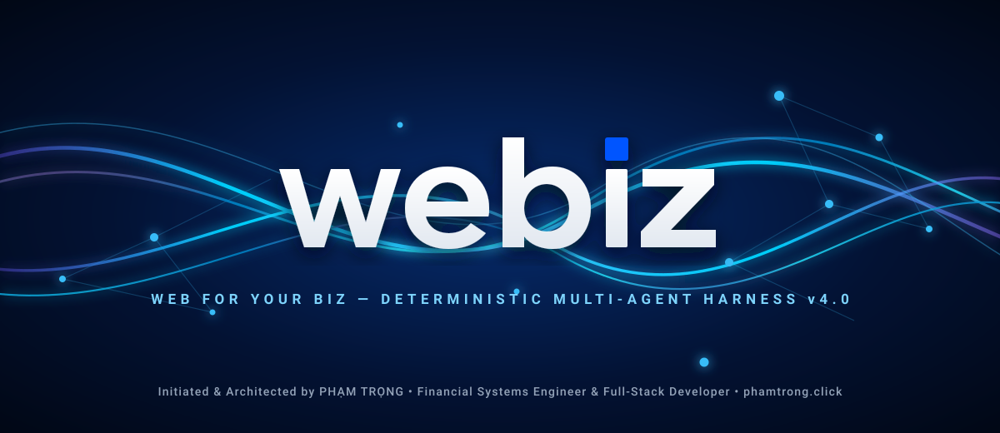

# 🌐 Webiz — Web For Your Biz (v4.0)
### Anthropic-Grade Deterministic Multi-Agent Software Factory

**Người khởi tạo & Kiến trúc sư trưởng (Creator & Chief Concept Architect):** **[Phạm Trọng](https://phamtrong.click)**  
*Financial Systems Engineer • Full-Stack Developer • Founder of Webiz*  
🔗 **Portfolio & Hệ sinh thái chính thức:** **[https://phamtrong.click](https://phamtrong.click)**

---

## 1. Triết Lý Kiến Trúc v4.0: "Deterministic Code Harness Over Prompt Advice"

Khác với các hệ thống Multi-Agent thế hệ cũ vốn chỉ dựa vào văn bản dặn dò LLM (dễ dẫn đến *ảo giác hoàn thành*, *tự sửa cờ duyệt*, hoặc *vòng lặp vô tận*), **Webiz Autonomous Software Factory v4.0** tách biệt hoàn toàn **Tầng Suy Luận (Agent Reasoning)** và **Tầng Cưỡng Chế Thực Thi (Node.js Deterministic Harness)**:

1. **Một Nguồn Sự Thật Duy Nhất (Single Source of Truth):** `contracts/schema.prisma` (Database), `contracts/openapi.yaml` (API chuẩn lỗi **RFC 9457**), và `contracts/traceability-spec.json` (Ma trận yêu cầu) được niêm phong bằng khóa mật mã `SHA-256`.
2. **Trạng Thái Ngoại Vi Bất Biến (`.git/webiz-state/`):** Bộ đếm lỗi **Circuit-Breaker**, lịch sử bác bỏ kèm **Defect Fingerprint** và **Biên nhận Nghiệm thu Mật mã (`attestation.receipt.json`)** nằm ngoài cây thư mục làm việc của Git — đảm bảo lệnh Rollback không bao giờ xóa mất bộ đếm lỗi và không một Agent nào có thể tự làm giả chữ ký duyệt.
3. **Tương Thích Kép Tự Động (`.agent/` & `.antigravity/`):** Tự động nạp toàn bộ Rules, Agents, Workflows trên mọi phiên bản Antigravity và VS Code.

---

## 2. Đồ Thị Quy Trình Vận Hành Tự Hành (Deterministic State Machine)

```mermaid
stateDiagram-v2
    direction TB
    [*] --> Stage00_Architect: Gửi PROJECT_BRIEF.md / AUDIT_OR_UPGRADE_REPORT.md

    state "Stage 00: 00-Chief-Architect & Cổng Duyệt PRD" as Stage00_Architect {
        [*] --> SanitizeInbox: Chạy sanitize-inbox.mjs (Chống Prompt Injection)
        SanitizeInbox --> SelectProfile: Chọn Profile (static-marketing | crud-webapp | enterprise-saas)
        SelectProfile --> HumanPRDGate: Xác nhận HUMAN_SIGN_OFF.json
        HumanPRDGate --> SealContracts: Xuất schema.prisma + openapi.yaml + Khóa SHA-256
    }

    Stage00_Architect --> Stage01_Engineering: Hợp đồng đã niêm phong SHA-256

    state "Stage 01 & 02: Thực Thi Kỹ Thuật & Hạ Tầng Kiểm Thử" as Stage01_Engineering {
        [*] --> TestInfra: 01-Backend-Data: Dựng docker-compose.test.yml + Migration (up/down.sql)
        TestInfra --> BackendImpl: 01-Backend-Data: API chuẩn RFC 9457 + Prisma RLS + Unit Test >= 90%
        --
        [*] --> FrontendImpl: 02-Frontend-Artisan: Next.js 4 States + WCAG AA (axe-core) + NĐ 13/2023/NĐ-CP
    }

    Stage01_Engineering --> Stage03_SecOps: Kiểm tra enforce-scope.mjs & ast-audit.mjs

    state "Stage 03: 03-SecOps-Auditor (Kiểm Toán Độc Lập)" as Stage03_SecOps {
        [*] --> SecretAndSqlScan: Chạy secops-scan.mjs (AWS/Stripe/OpenAI/DB URI & SQL Guard)
        SecretAndSqlScan --> SecurityTests: Ghi kịch bản kiểm thử bảo mật vào inquisitor-vault/
    }

    Stage03_SecOps --> Stage99_Inquisitor: Nộp hồ sơ kiểm định

    state "Stage 99: 99-Inquisitor-QA (Toà Án Nghiệm Thu Đối Kháng)" as Stage99_Inquisitor {
        [*] --> BlackboxE2E: Chạy E2E độc lập trên docker-compose.test.yml
        BlackboxE2E --> TraceabilityCheck: Chạy verify-traceability.mjs (Chống ma trận rỗng & test rỗng)
        TraceabilityCheck --> RubricEval: Phân loại BLOCKER / MAJOR / MINOR
    }

    Stage99_Inquisitor --> CircuitBreakerLoop: Có lỗi BLOCKER hoặc MAJOR

    state "Cầu Chì & Mã Vân Tay Lỗi (.git/webiz-state/)" as CircuitBreakerLoop {
        [*] --> CalcFingerprint: Tính SHA-256 Defect Fingerprint
        CalcFingerprint --> CheckAttempt: Kiểm tra số lần lặp (Tối đa 3 lần/fingerprint)
    }

    CircuitBreakerLoop --> Stage01_Engineering: Retry < 3 (Trả về đúng Kỹ sư phụ trách)
    CircuitBreakerLoop --> Stage00_Architect: Retry >= 3 (Mở cầu chì -> Triệu tập Kiến trúc sư & Con người)

    Stage99_Inquisitor --> Stage04_Release: Đạt 100% -> Cấp biên nhận attestation.receipt.json

    state "Stage 04: 04-Release-SRE & Cổng Duyệt Production" as Stage04_Release {
        [*] --> VerifyReceipt: Xác thực chữ ký SHA-256 trong attestation.receipt.json
        VerifyReceipt --> DeployStaging: Tự động triển khai Staging + Healthcheck
        DeployStaging --> HumanProdGate: Chờ Con Người Bấm Duyệt Production (GitHub Environment Gate)
    }

    Stage04_Release --> [*]: Phát hành Production hoàn tất
```

---

## 3. Ma Trận Phân Quyền 6 Đội Chuyên Biệt & Chốt Chặn Thực Thi (`scripts/harness/`)

| Mã Định Danh | Vai Trò Chuyên Môn | Chỉ Được Phép Ghi (`write_scope`) | Cấm Chạm Vào (`forbidden_scope`) | Công Cụ Cưỡng Chế Kiểm Tra |
| :--- | :--- | :--- | :--- | :--- |
| **`00-chief-architect`** | Tổng Công Trình Sư & Quản Trị Hợp Đồng | `contracts/**`, `.agent/locks/**` | `workspace/**`, `traceability-status.json` | `sanitize-inbox.mjs`, `contract-lock.mjs --seal` |
| **`01-backend-data-engineer`** | Kỹ Sư Dữ Liệu, Backend & Hạ Tầng Test | `workspace/database/**`, `workspace/backend/**`, `infra/docker-compose.test.yml`, `contracts/ccr/**` | `contracts/*.yaml`, `contracts/*.prisma`, `inquisitor-vault/**` | `enforce-scope.mjs`, `ast-audit.mjs`, `secops-scan.mjs` |
| **`02-frontend-artisan`** | Kỹ Sư Giao Diện, WCAG AA & i18n/SEO | `workspace/frontend/**`, `contracts/ccr/**` | `workspace/backend/**`, `contracts/*.yaml`, `inquisitor-vault/**` | `enforce-scope.mjs`, `ast-audit.mjs` |
| **`03-secops-auditor`** | Kiểm Toán Viên An Ninh & Chuỗi Cung Ứng | `inquisitor-vault/security-tests/**`, `BACKLOG.md` | `workspace/backend/src/**`, `workspace/frontend/src/**`, `contracts/**` | `secops-scan.mjs` |
| **`99-inquisitor-qa`** | **Đội Nghiệm Thu Tối Cao & Phác Thảo Nâng Cấp** | `inquisitor-vault/**`, `BACKLOG.md` | `workspace/**`, `contracts/traceability-spec.json` | `verify-traceability.mjs`, `verify-pipeline.mjs --attest` |
| **`04-release-sre`** | Kỹ Sư Hạ Tầng Phát Hành & SRE | `infra/**`, `.github/workflows/**` | `workspace/**`, `contracts/**`, `inquisitor-vault/**` | Kiểm tra chữ ký `attestation.receipt.json` & Human Gate |

---

## 4. Bảng Lệnh Điều Khiển Thực Thi & Kiểm Thử Đối Kháng

| Mục Đích Vận Hành | Lệnh Terminal (Chuẩn Node.js Đa Nền Tảng) | Lệnh Workflow Trong Antigravity |
| :--- | :--- | :--- |
| **Chạy tự động toàn bộ dự án mới từ A–Z** | `npm run verify:attest` | `/build-from-zero` |
| **Phác thảo & Nâng cấp an toàn từ báo cáo** | `npm run blast:calc` | `/upgrade-from-report` |
| **Đề xuất sửa đổi hợp đồng kỹ thuật (CCR)** | `npm run contract:seal` | `/contract-change-request` |
| **Chạy toàn bộ 6 chốt chặn cưỡng chế code** | `node scripts/harness/verify-pipeline.mjs --attest` | `/inquisitor-audit-loop` |
| **Chạy 3 vòng kiểm thử tiêm lỗi (Chaos Self-Test)** | `node scripts/harness/selftest-chaos.mjs` | — |

---

  <b>Webiz — Web For Your Biz (v4.0 Deterministic Edition)</b> • Khởi tạo & Thiết kế bởi <b><a href="https://phamtrong.click">Phạm Trọng</a></b>

